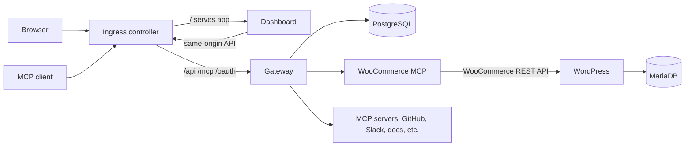

# kube-mcp

**kube-mcp** is a self-hosted MCP gateway for a team. It connects MCP servers once, then gives members a permission-controlled endpoint, a web dashboard, and an optional chat agent that calls tools as the signed-in member. The included example integration is a WooCommerce store.

The same Helm stack supports local development on Kind and a small production-like k3s deployment on AWS. The local setup builds application images from this checkout; production values point at GitHub Container Registry images.

## What it includes

- **MCP gateway:** aggregates tools from configured Streamable HTTP MCP servers, routes calls, checks permissions, and records outcomes.
- **Dashboard:** React app for server configuration, members, roles, per-tool access, client keys, OAuth providers, model settings, chat, and audit history.
- **Identity and authorization:** password and Google sign-in, browser sessions, API keys, MCP OAuth with PKCE, roles, server grants, and tool rules.
- **WooCommerce example:** WordPress, WooCommerce, MariaDB, and a dedicated `woo-mcp` service that exposes store operations to the gateway.
- **Operations:** Helm charts, local Kind setup, GitHub Actions, Terraform for a two-node AWS k3s environment, and Argo CD GitOps.

## Architecture at a glance



The gateway is the policy enforcement point. It authenticates each call, resolves the member's current permissions, selects the upstream, and writes an audit event. A gateway credential is not forwarded upstream; configured shared credentials or the member's own upstream OAuth token are used instead. See [System design](docs/SYSTEM-DESIGN-AND-TRADEOFFS.md) for request flows, state, tradeoffs, and scaling limits.

## Run locally on Kind

### Prerequisites

Install Docker, Kind, kubectl, and Helm. The local ingress binds host port **80**; it must be available. The bootstrap script creates a single-node Kind cluster named `kube-mcp` if one does not already exist.

From the repository root:

```sh
./scripts/init.sh
```

The script builds `woo-mcp:0.1.0`, `gateway:0.2.4`, and `dashboard:0.8.1`, imports them into the Kind node, installs or upgrades the `kube-mcp` Helm release using `charts/stack/values-dev.yaml`, then waits for store initialization and `woo-mcp` readiness.

Open:

| URL | Service |
|---|---|
| <http://localhost> | Dashboard and gateway API/MCP endpoint |
| <http://store.localtest.me> | WooCommerce storefront |
| <http://kube-mcp.localtest.me> | Dashboard alternate hostname |

`localtest.me` resolves to `127.0.0.1`. Sign in to the dashboard as `admin@example.com`. Read the generated bootstrap password without putting it in shell history:

```sh
kubectl -n kube-mcp get secret gateway-secrets \
  -o jsonpath='{.data.bootstrap-admin-password}' | base64 -d; echo
```

The store admin is at <http://store.localtest.me/wp-admin/> with username `admin`. Read its generated password from `store-secrets`:

```sh
kubectl -n kube-mcp get secret store-secrets \
  -o jsonpath='{.data.wp-admin-password}' | base64 -d; echo
```

The local chart configures a public Google OAuth client ID for the `http://localhost` origin. Password sign-in works without Google configuration. See [Local setup](docs/SETUP.md) for cluster checks, image refresh, an optional Calico policy-enforced path, and troubleshooting.

### Live AWS deployment

The current AWS deployment is reachable at:

| Service | URL |
|---|---|
| WooCommerce store | <https://store.13.200.126.173.nip.io> |
| Dashboard and gateway | <https://kube-mcp.13.200.126.173.nip.io> |
| Gateway health check | <https://kube-mcp.13.200.126.173.nip.io/healthz> |
| MCP endpoint | <https://kube-mcp.13.200.126.173.nip.io/mcp> |

The dashboard and MCP endpoint share a hostname. The dashboard requires sign-in, and MCP clients need an API key or OAuth authorization. These links depend on the AWS deployment remaining online; see [Setup and operations](docs/SETUP.md) for deployment details.

### Refresh a local image

The dev image tags use `IfNotPresent`; after rebuilding an image with the same tag, import it and restart the matching deployment so Kubernetes starts a new pod:

```sh
docker build --provenance=false --sbom=false -t dashboard:0.8.1 dashboard
docker save --platform linux/amd64 dashboard:0.8.1 | \
  docker exec -i kube-mcp-control-plane ctr --namespace=k8s.io images import --digests --snapshotter=overlayfs -
kubectl -n kube-mcp rollout restart deployment/dashboard
kubectl -n kube-mcp rollout status deployment/dashboard --timeout=3m
```

Use the equivalent build context, tag, and deployment name for `gateway` or `woo-mcp`. The direct import form also works with Docker installations where `kind load docker-image` cannot create its temporary directory.

## Access and use

### Dashboard

The **Overview** shows gateway and tool activity. **MCP servers** manages upstream connections. **Clients** creates and revokes personal MCP keys. **Chat** uses the configured model and the current member's allowed tools. **Security** manages members, roles, tool permissions, and audit history. **Settings** configures OAuth providers and the chat model. The mobile navigation selector exposes the same pages on small screens.

Customers can use the storefront and register through **My account**. The demo cluster does not include an email server, so WooCommerce email delivery is not configured.

### MCP endpoint

The endpoint is `/mcp` on the dashboard host:

| Environment | MCP endpoint |
|---|---|
| Local | <http://localhost/mcp> |
| AWS production | <https://kube-mcp.13.200.126.173.nip.io/mcp> |
| Other production deployments | <https://your-dashboard-host/mcp> |

Create an API key from **Clients** and configure the MCP client to send it as a Bearer token. Example:

```sh
claude mcp add --transport http kube-mcp http://localhost/mcp \
  --header "Authorization: Bearer <your-key>"
```

Keys are shown only once and stored hashed. OAuth-capable MCP clients can use the gateway's browser authorization flow instead.

### Add an upstream MCP server

An administrator with `servers.manage` opens **MCP servers → Add MCP server**, provides a slug and Streamable HTTP URL, and configures either shared credentials or a supported per-member OAuth provider. Tool names are prefixed with the server slug, for example `woocommerce__list_products`. Each call still goes through the gateway's permission check.

### Google sign-in and other OAuth providers

Google sign-in needs the exact dashboard origin in the Google OAuth client's **Authorized JavaScript origins**. For local development, that origin is `http://localhost`. Upstream OAuth callbacks use:

```text
<dashboard-origin>/api/oauth/<provider-slug>/callback
```

For example, use `http://localhost/api/oauth/github/callback` locally. Provider client secrets are entered in the dashboard and stored encrypted by the gateway.

## Environments and deployment

| Environment | Deployment | Values and images | Ingress / TLS |
|---|---|---|---|
| Local | Kind + Helm, release `kube-mcp` in namespace `kube-mcp` | `charts/stack/values-dev.yaml`; application images built locally | ingress-nginx on host port 80; HTTP |
| Production-like | k3s on AWS EC2 + Argo CD | `charts/stack/values-prod.yaml`; versioned GHCR images | Public ingress; cert-manager and HTTPS |

`charts/stack/values.yaml` contains shared defaults; environment-specific public settings and image references belong in the dev and prod values files. Runtime credentials are Kubernetes Secrets, not Helm values committed to Git. The GitHub image workflow publishes images and updates production image tags; Argo CD watches Git and syncs the stack. AWS provisioning and first bootstrap are documented in [Setup and operations](docs/SETUP.md).

## Security and network policies

Only the ingress controller is intended to receive external traffic. The dashboard, gateway, databases, and MCP service use in-cluster Services. NetworkPolicy resources restrict selected **ingress** paths; they do not currently restrict egress. Enforcement depends on the cluster CNI: k3s enforces policies, and the optional Kind Calico setup does; the default Kind cluster created by `scripts/init.sh` uses kindnet, which does not enforce NetworkPolicy. Do not treat those policy objects as an isolation boundary on default Kind networking.

See [Networking](docs/NETWORKING.md) for ports, request paths, TLS, firewall rules, and the exact policy rules. See the [Threat model](docs/THREAT-MODEL.md) for controls and known gaps.

## Scaling and current limits

The dev and prod values now run two gateway replicas against the same PostgreSQL Service. Gateway MCP/login rate-limit windows and upstream OAuth handshakes are stored in PostgreSQL, so they are shared across replicas. The chart adds a gateway PodDisruptionBudget and best-effort node spreading when the gateway has more than one replica. There is no HPA. PostgreSQL, MariaDB, and WordPress remain single replicas with single-node persistent storage; gateway scaling does not make those components highly available. Read [Operations and scaling](docs/OPERATIONS-AND-SCALING.md) before increasing replicas or moving beyond the demo/small-team deployment.

## Repository map

| Path | Purpose |
|---|---|
| `services/gateway` | Gateway API, MCP aggregation, identity, permissions, chat, OAuth, and metrics |
| `services/woo-mcp` | WooCommerce MCP server |
| `dashboard` | React dashboard and nginx image |
| `charts/stack` | Full Helm release and dev/prod values |
| `charts/{gateway,mcp,store,ingress}` | Component Helm charts and templates |
| `yamls/` | Alternate plain Kubernetes manifests for manual local setup |
| `infra/kind` | Kind network configurations and Calico manifest |
| `infra/aws/k3s` | Terraform for the AWS k3s nodes and security group |
| `gitops/` | Argo CD root, platform, and application definitions |
| `.github/workflows` | Build, chart, and Kind deployment checks; image publishing |
| `scripts/init.sh` | One-command local Kind + Helm installation |
| `scripts/bootstrap.sh` | One-time AWS cluster secret, certificate, Argo CD, and GitOps bootstrap |

## Documentation

- [Local setup and deployment](docs/SETUP.md)
- [System design and tradeoffs](docs/SYSTEM-DESIGN-AND-TRADEOFFS.md)
- [Operations, capacity, and scaling](docs/OPERATIONS-AND-SCALING.md)
- [Networking, ingress, and policies](docs/NETWORKING.md)
- [Store setup](docs/STORE-SETUP.md)
- [Threat model and known gaps](docs/THREAT-MODEL.md)
