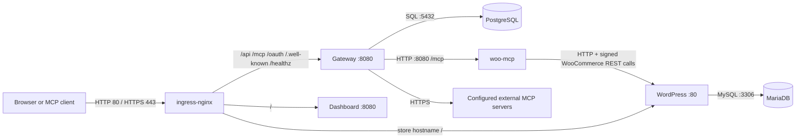

# Networking, ingress, and NetworkPolicies

This guide describes the current chart wiring. The local Helm stack and production Helm stack share the same Services, Ingress rules, and policy templates; values choose the hosts, TLS, storage class, and images. The `yamls/` manifests are a separate older/manual deployment layout and use different namespaces.

## Request paths



Within the Helm stack, the workloads and ingress controller are in namespace `kube-mcp`. Services are cluster-internal. The only host entry point is the ingress controller. The gateway metrics endpoint (`/metrics`) is not included in the Ingress rules.

## Hostnames and ports

| Environment | Dashboard / gateway | Store | Ingress entry |
|---|---|---|---|
| Kind dev | `http://localhost` and `http://kube-mcp.localtest.me` | `http://store.localtest.me` | Host port 80 mapped by Kind |
| Production-like | `gateway.publicBaseUrl` and `ingress.dashboard.hosts` in `charts/stack/values-prod.yaml` | `store.siteUrl` and `ingress.store.host` in the same file | EC2 server ports 80 and 443 |

`localtest.me` resolves to loopback. The Kind config maps host port 80 to container port 80 and host port 8443 to container port 443; the default dev values use HTTP, so 8443 is not needed for normal local access.

In production, the checked-in values currently use `nip.io` names containing a specific IP. Change the hosts, `store.siteUrl`, `gateway.publicBaseUrl`, `mcp.store.siteUrl`, and OAuth allowed origins/callbacks together when using another address or domain. The store's `mcp.store.siteUrl` remains HTTP for internal WooCommerce OAuth 1.0a signature matching; the public store URL is HTTPS.

## Ingress routing

The dashboard Ingress routes, for each configured dashboard host:

| Path | Destination |
|---|---|
| `/api` | `gateway:8080` |
| `/mcp` | `gateway:8080` (exact path) |
| `/oauth` | `gateway:8080` |
| `/.well-known` | `gateway:8080` |
| `/healthz` | `gateway:8080` |
| `/` | `dashboard:8080` |

The store Ingress sends `/` for the configured store host to `wordpress:80`. Production values also enable a hostless rule, so a request to the bare IP reaches the store and uses the controller's default certificate.

TLS terminates at ingress-nginx. Pod-to-pod HTTP is not encrypted by this configuration. NetworkPolicy is not encryption; use a service mesh or application-level TLS if the cluster trust boundary requires encrypted east-west traffic.

## TLS and DNS

- **Kind:** dev values disable TLS and use HTTP on localhost.
- **Production hostnames:** `ingress.tls.enabled` and the `letsencrypt-prod` ClusterIssuer enable cert-manager-managed certificates for the named dashboard and store hosts. Public DNS and inbound HTTP/HTTPS must reach the ingress controller for issuance and renewal.
- **Bare IP:** the bootstrap script creates a self-signed certificate Secret named `ip-tls`; ingress-nginx uses it as its default certificate. Browsers warn because the certificate is not publicly trusted. The named host certificates are the normal browser entry points.

The Terraform security group in `infra/aws/k3s/main.tf` allows SSH and the Kubernetes API from `admin_cidr`, web ports 80/443 from the internet, and k3s node traffic between the instances. Review and narrow these rules for the actual environment. The EC2 Terraform provisions infrastructure only; operators install and configure k3s separately.

## NetworkPolicy rules in the Helm charts

The charts install these ingress rules in the release namespace:

| Selected pods | Inbound source and port |
|---|---|
| Gateway | ingress-nginx controller pods |
| Dashboard | ingress-nginx controller pods |
| PostgreSQL | Gateway pods, TCP 5432 |
| `woo-mcp` | Gateway pods, TCP 8080 |
| WordPress | ingress-nginx controller pods and `woo-mcp`, TCP 80 |
| MariaDB | WordPress and the store setup Job, TCP 3306 |

The policies select pods by labels, not Services. In the chart, the ingress controller is deployed into the same `kube-mcp` namespace and has the `app.kubernetes.io/name: ingress-nginx` label. When deploying components in different namespaces, review and adapt the namespace and pod selectors.

These templates declare ingress isolation for selected targets. They do **not** define egress rules; egress from selected pods remains allowed. They also do not implement an explicit default-deny policy for every pod in the namespace. The policies limit the listed inbound paths; they are not a complete namespace firewall.

### CNI enforcement matters

Kubernetes stores NetworkPolicy resources, but only a policy-capable CNI enforces them.

- `scripts/init.sh` creates the default `infra/kind/kind.yaml` cluster with kindnet. kindnet does not enforce NetworkPolicy. The policies are present but are not an effective boundary on this default local path.
- For local enforcement, create the cluster with `infra/kind/kind-calico.yaml`, apply the pinned `infra/kind/calico-v3.32.2.yaml` manifest, wait for Calico, and then run `scripts/init.sh`. Steps are in [SETUP.md](SETUP.md).
- The production target is k3s, which includes NetworkPolicy enforcement through its configured network-policy controller. Verify the actual CNI and enforcement in any replacement cluster before relying on the policies.

Do not run a connectivity test against default Kind and interpret a successful connection as evidence that the policy YAML is wrong; the CNI is expected to ignore it.

## Useful checks

```sh
kubectl -n kube-mcp get ingress
kubectl -n kube-mcp get networkpolicy
kubectl -n kube-mcp get pods -o wide
kubectl -n kube-mcp get svc
curl -i http://localhost/healthz
curl -I http://localhost/
curl -I http://store.localtest.me/
```

For a refused request, inspect the Ingress host/path, Service selector and endpoints, pod readiness, and the active CNI before changing policies:

```sh
kubectl -n kube-mcp describe ingress mcp-dashboard
kubectl -n kube-mcp get endpoints gateway dashboard wordpress
kubectl -n kube-mcp describe networkpolicy <policy-name>
kubectl -n kube-system get pods -o wide
```

See [Setup](SETUP.md) for local deployment and [Threat model](THREAT-MODEL.md) for security limitations.
